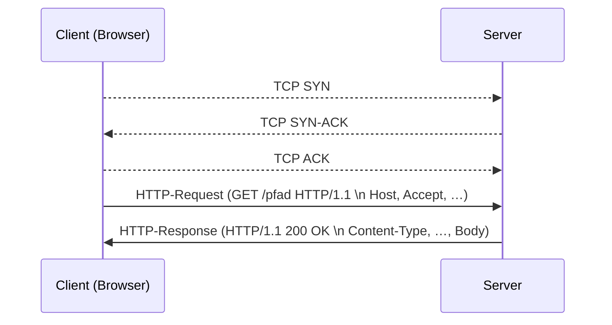

# [HTTP](https://de.wikipedia.org/wiki/Hypertext_Transfer_Protocol)
**H**yper**t**ext **T**ransfer **P**rotocol


> **💬** Was wissen Sie über HTTP? In welchem Zusammenhang steht es mit HTML?

* Client-Server-Protokoll
* zur Übertragung von Daten auf Anwendungsebene
* zustandslos *(HTTP 1.0)*

> **❓❗** Wie funktioniert HTTP?



## OSI-Layer

**5-7**

* HTTP/1 und HTTP/2 bauen auf TCP/IP (Layer 4/3) auf
  * HTTP/3 nutzt QUIC+UDP auf der Transportschicht
* wenn [SSL/TLS](https://johannesloetzsch.github.io/LF11b/krypto-auth/tls.html) genutzt wird, ist es wie ein zusätzlicher Layer zwischen 4 und 5

## Ports

* **80** http://
* 443 https://

## Methoden (Verben)

| Verb     | Bedeutung           | Safe | Idempotent | Cacheable |
| -------- | ------------------- | ---- | ---------- | --------- |
| **POST** | **C**reate resource | Nein | Nein       | (Nein)    |
| **GET**  | **R**ead resource   | Ja   | Ja         | Ja        |
| PUT      | **U**pdate resource | Nein | Ja         | Nein      |
| DELETE   | **D**elete resource | Nein | Ja         | Nein      |
| …        | …                   | …    | …          | …         |

> **❓💬** Warum gibt es verschiedene HTTP Verben?
>
> [Warum ist die Unterscheidung wichtig](https://developer.mozilla.org/en-US/docs/Web/HTTP/Reference/Methods#safe_idempotent_and_cacheable_request_methods)?

## Statuscodes

### **1xx** Info
### **2xx** Erfolg
* **200** OK
* 201 Created
### **3xx** Umleitung
* **301** Redirect (Moved Permanently)
* 304 Not Modified
### **4xx** Client-Fehler
* 400 Bad Request
* 401 Unauthorized
* 403 Forbidden
* **404** Not Found
* *418 I'm a Teapot (Scherzcode, April-Scherz-RFC)*
### **5xx** Server-Fehler
* **500** Internal Server Error
* 503 Service Unavailable

## Beispiel

> **💻** Einzeiler um einen Webserver zu starten, der das aktuelle Verzeichnis via HTTP ausliefert:
>
> ```sh
> python -m http.server
> ```

> **💻** Einen HTTP-Request auf der Kommandozeile ausführen und den vollständigen Request+Response anschauen: 
>
> ```sh
> curl -v localhost:8000/README.md
> ```

> **💻** Wir könnten zum debuggen den HTTP-Request auch händig schreiben:
> ```sh
> telnet localhost 8000
> ```

### HTTP-Request

```
GET /README.md HTTP/1.1
Host: localhost:8000
User-Agent: curl
Accept: */*

```

- Method + Path + Version
- [Request Headers](https://developer.mozilla.org/en-US/docs/Glossary/Request_header) + Newline
- Body (optional)

### HTTP-Response

```
HTTP/1.0 200 OK
Server: SimpleHTTP/0.6 Python/3
Date: Wed, 04 Nov 2026 13:37:00 GMT
Content-type: text/markdown
Content-Length: 28
Last-Modified: Wed, 04 Nov 2026 12:34:00 GMT

…hier kommt der Inhalt…
```

- Version + Status Code + Status Text
- [Response Headers](https://developer.mozilla.org/en-US/docs/Glossary/Response_header) + Newline
- Body

## URLs

> **❓❗** Was sind [URLs](https://johannesloetzsch.github.io/LF10b/dienste/dns.html#URI)?

## MIME type

> **❓❗** Was sind [MIME types](https://de.wikipedia.org/wiki/Internet_Media_Type)?

## Praxis

> **💻** Machen Sie sich mit der **Developer-Console** ihres Webbrowsers vertraut.
>
> Schauen Sie sich verwendete Requests, Responses, Methoden, Statuscodes, MIME types an.

> **💻** Probieren Sie den folgenden Befehl mit der Eingabe darunter aus:
> ```sh
> telnet ascii.art 80
> ```
> ```
> GET /LgB625Zh/raw HTTP/1.1
> Host: ascii.art
>
>
> ```
> (Bitte Zeilenumbrüche am Ende des HTTP-Requests beachten)

> **💻** Schauen Sie sich in **Wireshark** HTTP-Verkehr an.
>
> * Was sehen Sie bei Verwendung von TLS (https)?
> * Sehen Sie, wie HTTP auf den unteren OSI-Protokoll-Schichten aufbaut?
> * Schauen Sie, welche HTTP-Versionen von ihrem Browser Verwendet werden. Welche Besonderheiten finden Sie?

> **💻** Starten Sie einen kleinen **Webserver**.
>
> Vergleichen Sie verschiedene Lösungen.
