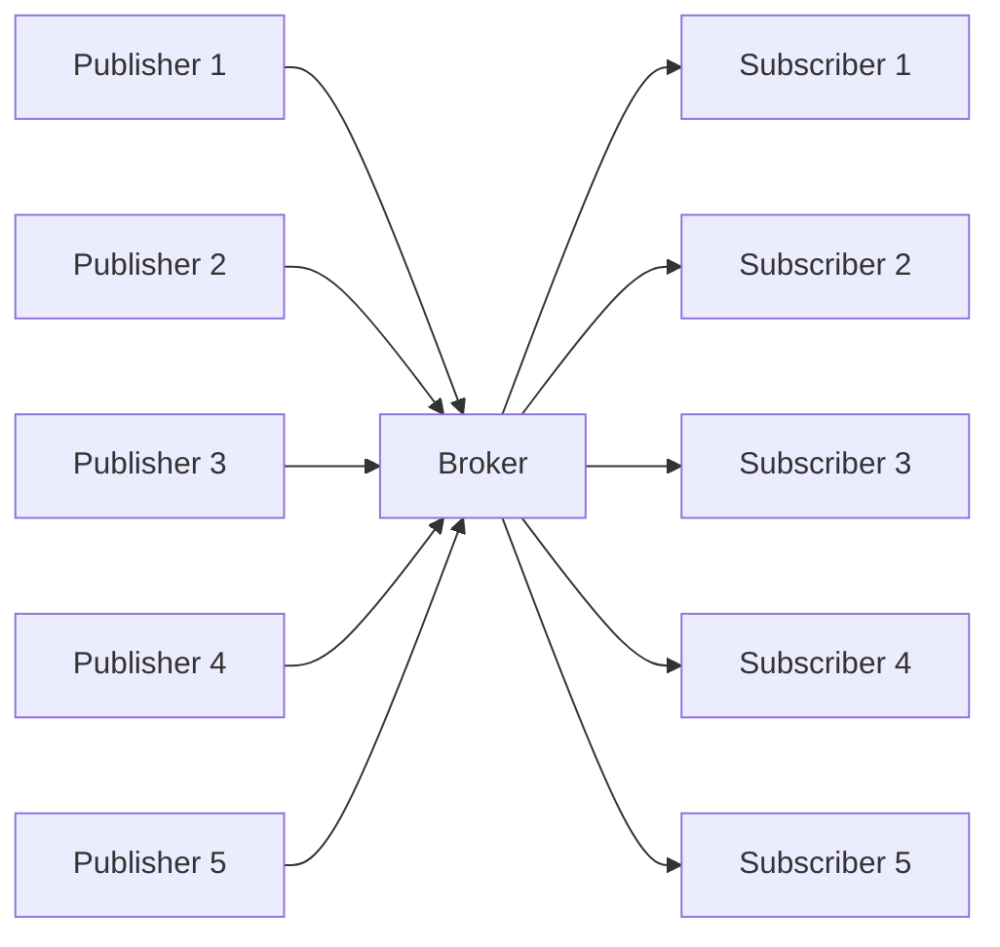
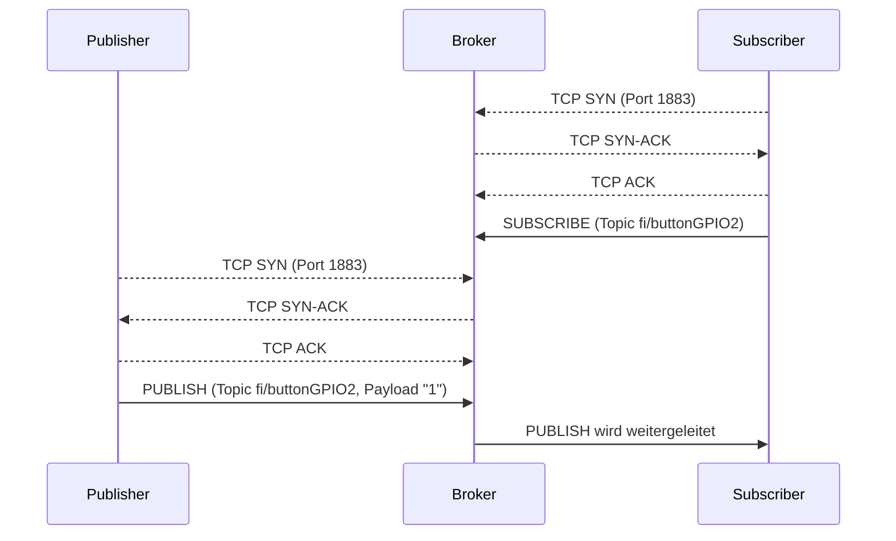

# [MQTT](https://de.wikipedia.org/wiki/MQTT)
**M**essage **Q**ueuing **T**elemetry **T**ransport

* Publish/Subscribe

* Clients („**Subscriber**“) können ein „Topic“ abonnieren
  * TCP-Verbindung wird offen gehalten
  * Server („**Broker**“) kann Clients über bestehende Verbindung über Updates informieren\
  (sobald Broker Nachrichten von einem „**Publisher**“ erhält)

* Üblicherweise über **TCP**
  * **1883** mqtt://
  * 8883 mqtts://
  * auch über Websockets oder UDP („MQTT-SN“ für Sensornetzwerke) möglich



## Sequenzdiagramm



## Vergleich mit HTTP

|                   | HTTP                    | MQTT                                           |
| ----------------- | ----------------------- | ---------------------------------------------- |
| Typische Nutzung  | **Web, API**            | **IoT/M2M**, Sensorik, instabile Netze         |
| Muster            | Request-Response        | Publish/Subscribe                              |
| Kopplung          | Client kennt Server     | Publisher/Subscriber durch Broker entkoppelt   |
| Richtung          | durch Client initiiert  | Broker kann an Subscriber pushen               |
| Overhead          | textuelle Header        | winziger Binärheader (~2 Byte)                 |
| Zustand           | zustandslos             | Broker merkt sich Sessions & Retained Messages |

## Demo

> **💻** Broker starten, Subscriben, Publishen
>
> ```bash
> mosquitto  ## startet den broker [1]
> mosquitto_sub -h 127.0.0.1 -p 1883 -u fi -P geheim -t fi/buttonGPIO2
> mosquitto_pub -h 127.0.0.1 -p 1883 -u fi -P geheim -t fi/buttonGPIO2 -m '1'
> ```

> [1] **⚠️** Bitte [**Firewall**](https://johannesloetzsch.github.io/LF11b/netzwerk/firewalls.html) (Paketfilter/SPI) nutzen ;)
>
> → [Anleitung für Windows](https://support.microsoft.com/de-de/windows/security/windows-security/firewall-and-network-protection-in-the-windows-security-app) \
> → [GUI-Beispiel für Linux](https://github.com/costales/gufw)

> **💬❓** Welche Sicherheitslücke hätte obriges Setup, wenn sie es produktiv in Ihrem Netz einsetzen würden?

## Prüfungsaufgabe

> **📝❗** FiSi AP2 Analyse Sommer 2025 Aufgabe 4c
